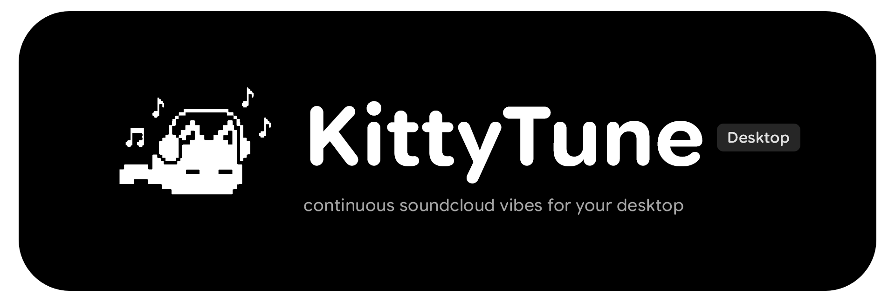
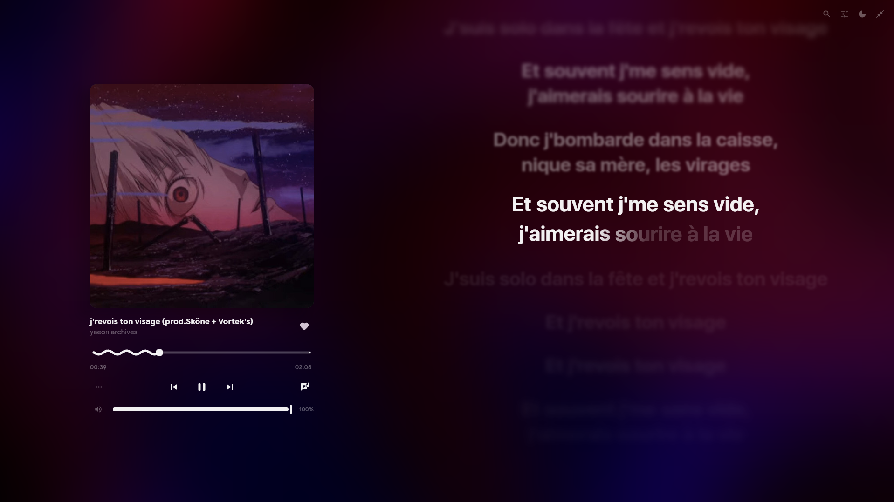
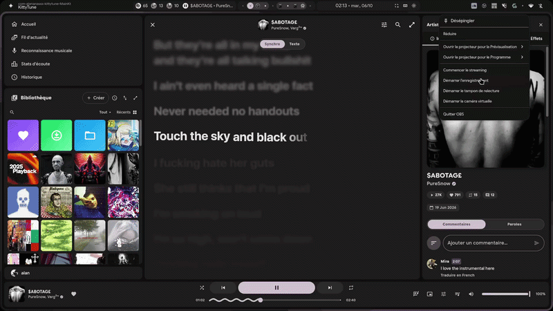
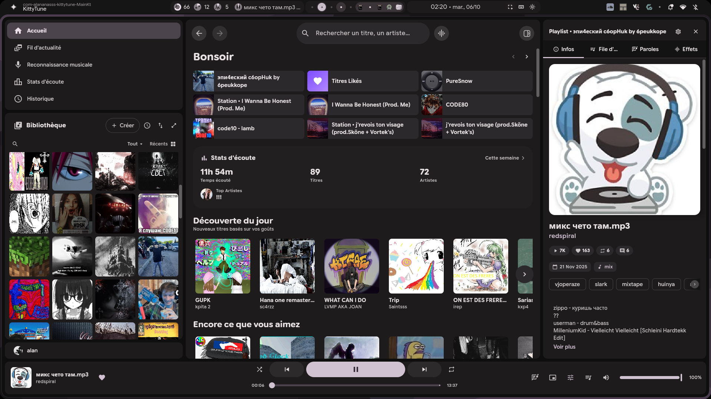

<p align="center">
  <a href="https://alan7383.github.io/kittytune-website/download" title="Download KittyTune"></a>
</p>

<p align="center">
  
</p>
<p align="center">
  <a href="https://alan7383.github.io/kittytune-website/download" title="Download KittyTune"></a>
</p>

<p align="center">
  <sub>KittyTune Desktop is in active beta. Found a bug? <a href="https://github.com/alan7383/KittyTuneDesktop/issues">Open an issue</a>.</sub><br/>
  <sub>Looking for Android? KittyTune is also available on <a href="https://github.com/alan7383/kittytune">Android</a>.</sub>
</p>

> [!NOTE]
> KittyTune Desktop is developed and tested primarily on Linux. Builds for Windows and macOS are experimental. If you hit bugs or rough edges on Windows or macOS, please report them in an issue or submit a pull request.

## About

KittyTune Desktop is a native desktop music player built with Kotlin and Compose Multiplatform, running directly on the JVM with zero Electron overhead.

Connect your real SoundCloud account with OAuth PKCE for full two-way synchronization: your likes, playlists, reposts, followed artists, listening history, and in-app direct messages stay in lockstep. You can stream your entire collection with instant full-library shuffle and zero advertisements.

Whenever a track has a studio release on Qobuz, TIDAL, or Deezer, KittyTune matches it via ISRC and swaps in lossless audio on the fly. For SoundCloud Go+ protected tracks, KittyTune uses native Widevine CDM decryption (on Linux directly, and on Windows through a native in-process ELF loader with no VM or WSL needed), routing raw PCM straight into the audio engine so equalizers, DSP effects, and offline caching work on protected music.

<br>

## Core features

| Feature | What it does | Details |
| :--- | :--- | :--- |
| Real SoundCloud sync | Connects to your actual SoundCloud account | OAuth PKCE syncs likes, playlists, reposts, stream feed, and in-app DMs |
| Lossless and Go+ DRM | Upgrades streams and unlocks protected tracks | ISRC matching pulls studio masters (Qobuz, TIDAL, Deezer); native Widevine CDM on Linux and Windows |
| Audio FX and Nightcore | Real-time audio transformations on any track | Independent pitch and tempo shift for nightcore or daycore, plus 34 DSP effects |
| Studio EQ and AutoEQ | 16-band graphic EQ paired with headphone tuning | 8,850+ measured AutoEQ profiles, peak limiting, spatial 8D audio, and lo-fi filters |
| Real-time lyrics | Syllable-level synchronized karaoke text | 14 providers, duet split, spring animations, and script translation |
| AI stem isolation | Separates vocals and instruments on your machine | HTDemucs v4 model accelerated by Vulkan GPU or ONNX Runtime |
| DJ Automix | Seamless transitions between tracks | Real-time beat tracking, Camelot wheel harmonic mixing, and bass ducking |
| Desktop companion | Ivy, an animated cat living on your screen | Reacts to playback mood and tempo; roams your desktop or docks in the app |
| Looping video canvas | Fullscreen video backgrounds and animated artwork | Plays Apple Music Canvas and TIDAL animated album art |
| Together rooms | Synchronized shared listening rooms | Real-time playback and shared queues over MQTT with invite codes |
| Native integrations | System-level desktop integration across platforms | Linux MPRIS v2, Windows SMTC, Discord Rich Presence, and Zapret proxy bypass |

<br>

### More in the box

| Area | Capabilities |
| :--- | :--- |
| Library management | Nested playlist folders, vibe filters, and playlist imports from Spotify, Apple Music, and Deezer |
| SoundCloud creator tools | Direct track uploader with cover art cropper, full artist discographies, and in-app direct messaging |
| Offline and local files | Offline track downloads, local folder media scanner, and full JSON library backup and restore |
| Music discovery | My Wave personalized endless radio, ShazamKit song recognition, and collectible Music Passport |

<br>

## Screenshots

<p align="center">
  
  <br><em>Fullscreen player with dynamic artwork canvas and expressive wavy slider.</em>
</p>

<br>

<p align="center">
  
  <br><em>Synchronized lyrics with karaoke tracking, spring animations, and duet singer split.</em>
</p>

<br>

<p align="center">
  
  <br><em>Home screen with SoundCloud stream, likes, playlists, and user library.</em>
</p>

<br>

## Comparison with the SoundCloud web app

| Capability | SoundCloud web | KittyTune Desktop |
| :--- | :--- | :--- |
| Application runtime | Browser tab | Native JVM desktop application |
| Account login and sync | Basic web session | Real OAuth PKCE sync: likes, playlists, reposts, and DMs |
| Playlist shuffle | Limited by lazy loading | Instant full-library shuffle without pagination |
| Audio quality upgrades | Standard 128 kbps MP3 or 256 kbps AAC | Lossless matching via Qobuz, TIDAL, Deezer |
| Protected Go+ playback | Web player only | Native Widevine CDM on Linux and Windows with raw PCM routing |
| Audio FX and Nightcore | None | Speed and pitch shift (nightcore/daycore), 16-band EQ, 34 DSP effects |
| Advertisements | Audio and banner ads | Zero ads |
| Synchronized lyrics | None | Syllable-level tracking, duet split, variable fonts |
| Video canvas | None | Apple Music Canvas and TIDAL animated artwork |
| Headphone calibration | None | AutoEQ database with 8,850+ profiles |
| DJ Automix | None | Beat-matched transitions and harmonic mixing |
| AI tools | None | Stem isolation via Demucs and ArtifactNet detector |
| Offline downloads | None | Full track and playlist downloads |
| Desktop pet companion | None | Interactive reactive cat (Ivy) |
| Collaborative rooms | None | Real-time synchronized listening rooms |
| Song recognition | None | Built-in ShazamKit recognition |
| Operating system media controls | Basic browser media keys | Native MPRIS D-Bus (Linux) and SMTC (Windows) |
| Discord status | Third-party browser extension required | Native Discord Rich Presence |
| Network circumvention | None | Built-in HTTP and SOCKS5 proxy with Zapret DPI tools |

<br>

## Keyboard shortcuts

### Playback and track controls

| Shortcut | Action |
| :--- | :--- |
| `Spacebar` | Play or pause |
| `Shift + Right` | Next track |
| `Shift + Left` | Previous track |
| `Right` | Seek forward 5 seconds |
| `Left` | Seek backward 5 seconds |
| `0` to `9` | Seek to percentage (0% to 90%) |
| `Shift + L` | Toggle repeat mode |
| `Shift + S` | Toggle shuffle mode |
| `L` | Like or unlike active track |
| `R` | Repost or un-repost active track |

### Volume and audio

| Shortcut | Action |
| :--- | :--- |
| `Shift + Up` | Increase volume |
| `Shift + Down` | Decrease volume |
| `M` | Mute or unmute |

### Navigation and panels

| Shortcut | Action |
| :--- | :--- |
| `S` | Open search |
| `P` | Open track details |
| `Q` | Toggle queue panel |
| `H` | Open keyboard shortcuts modal |
| `Escape` | Close overlay or navigate back |
| `Mouse Back / Forward` | Navigate history back or forward |
| `G` then `L` | Go to likes |
| `G` then `C` | Go to library |
| `G` then `H` | Go to history |
| `G` then `S` | Go to feed |
| `G` then `P` | Go to profile |

### Interface scaling

| Shortcut | Action |
| :--- | :--- |
| `Ctrl + +` / `Ctrl + =` | Zoom in |
| `Ctrl + -` | Zoom out |
| `Ctrl + 0` | Reset zoom to 100% |

## Download and installation

Pre-built binaries for Linux, Windows, and macOS are available on the [releases page](https://github.com/alan7383/KittyTuneDesktop/releases).

| Platform or distribution | Method | Package or command |
| :--- | :--- | :--- |
| Arch Linux | [AUR (kitty-tune-bin)](https://aur.archlinux.org/packages/kitty-tune-bin) | `yay -S kitty-tune-bin` |
| Arch Linux | Pacman package | `sudo pacman -U kitty-tune-*.pkg.tar.zst` |
| NixOS / Nix | Flake / Package | `nix run github:alan7383/KittyTuneDesktop` |
| Debian / Ubuntu / Mint | Debian package (`.deb`) | `sudo apt install ./kitty-tune_*_amd64.deb` |
| Fedora / RHEL / openSUSE | RPM package (`.rpm`) | `sudo dnf install ./kitty-tune-*.rpm` |
| Portable Linux | Standalone AppImage | `chmod +x KittyTune-*.AppImage && ./KittyTune-*.AppImage` |
| Windows and macOS | Installer / DMG (Experimental) | [GitHub Releases](https://github.com/alan7383/KittyTuneDesktop/releases) |
| Windows x64 | Portable ZIP with bundled Java runtime | [Windows guide](WINDOWS.md) |

To synchronize playback between paired Android and desktop devices, see the [Connect guide](CONNECT.md).

### Arch Linux

Option 1: AUR package

The package `kitty-tune-bin` is available on the Arch User Repository (AUR), maintained by Felitendo.

Install with yay:
```bash
yay -S kitty-tune-bin
```

Or with paru:
```bash
paru -S kitty-tune-bin
```

Option 2: Pacman package

Download the latest `.pkg.tar.zst` archive directly from releases and install with pacman:
```bash
sudo pacman -U kitty-tune-*.pkg.tar.zst
```

### NixOS and Nix

KittyTune Desktop has Flake support, a package derivation, and a NixOS module.

Run directly without installing:
```bash
nix run github:alan7383/KittyTuneDesktop
```

Temporary shell:
```bash
nix shell github:alan7383/KittyTuneDesktop
```

Declarative NixOS configuration (Flake):
Add KittyTune Desktop to your `flake.nix` inputs:

```nix
{
  inputs = {
    nixpkgs.url = "github:NixOS/nixpkgs/nixos-unstable";
    kittytune.url = "github:alan7383/KittyTuneDesktop";
  };

  outputs = { self, nixpkgs, kittytune, ... }: {
    nixosConfigurations.myhostname = nixpkgs.lib.nixosSystem {
      system = "x86_64-linux";
      modules = [
        kittytune.nixosModules.default
        {
          programs.kittytune.enable = true;
        }
      ];
    };
  };
}
```

Home Manager:
```nix
{ inputs, pkgs, ... }: {
  home.packages = [
    inputs.kittytune.packages.${pkgs.system}.default
  ];
}
```

Legacy Nix:
```bash
nix-build
./result/bin/kitty-tune
```

Development shell:
```bash
nix develop
./gradlew run
```

### Debian, Ubuntu, and Linux Mint

Download the `.deb` file from the releases page and install with apt:
```bash
sudo apt install ./kitty-tune_*_amd64.deb
```

### Fedora, openSUSE, and RHEL

Download the `.rpm` file from the releases page and install with dnf:
```bash
sudo dnf install ./kitty-tune-*.rpm
```

### Portable Linux AppImage

Download the standalone `.AppImage` from the releases page:
```bash
chmod +x KittyTune-*.AppImage
./KittyTune-*.AppImage
```

### Windows and macOS

Download pre-compiled binaries from the releases page:
* Windows: MSI installer or portable ZIP archive
* macOS: DMG disk image

Detailed Windows build and runtime notes are available in the [Windows guide](WINDOWS.md).

## Building from source

### Prerequisites
* JDK 21 or higher
* Git

```bash
git clone https://github.com/alan7383/KittyTuneDesktop.git
cd KittyTuneDesktop

# Run application
./gradlew run

# Package binary for your operating system
./gradlew packageDistributionForCurrentOS
```

## Credits and license

* Based on KittyTune for Android.
* Built with [Compose Multiplatform](https://github.com/JetBrains/compose-multiplatform), [MaterialKolor](https://github.com/jordond/MaterialKolor), and [FFmpeg](https://ffmpeg.org/).

Licensed under the MIT License.

## Contributors

Thanks to everyone who contributes to KittyTune Desktop:

[](https://github.com/alan7383/KittyTuneDesktop/graphs/contributors)

<p align="center">
  Maintained by <a href="https://github.com/alan7383">alan7383</a>.
</p>
